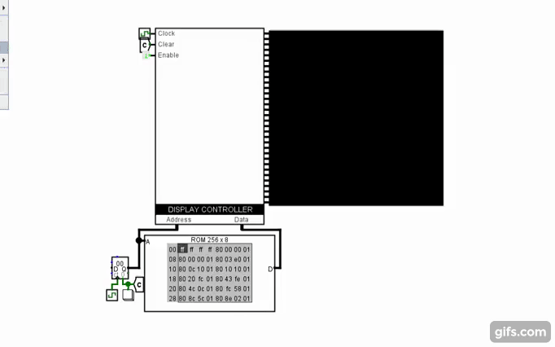

> ⏸️ **En pausa.** Desarrollo pausado temporalmente. Controlador de una pantalla LED de 32 bits diseñado en Logisim. Ver también el [procesador MIPS en Logisim](https://github.com/Lmendev/Procesador-MIPS-logisim).

# Controlador Pantalla Logisim
Controlador de pantalla LED de 32 bits en Logisim

## Acerca del proyecto

Sistema simple que interactúa con una pantalla LED de 32 x 32 bits

## Try the project

TODO

### Software requirements

- Logisim-Evolution
- Java

### Installation

* Step 1
* Step 2

### Usage

[to edit...]

## Contribuir

¡Gracias por considerar contribuir al proyecto! 

Siéntete libre de [crear un nuevo problema](https://github.com/lmendev/Controlador-pantalla-logisim/issues) con toda la información detallada

## Contáctame
Hazme saber tus comentarios 😄

- Sígueme en Twitter, comparto mi trabajo como desarrollador  
- ¿Qué te ha gustado del proyecto? 
